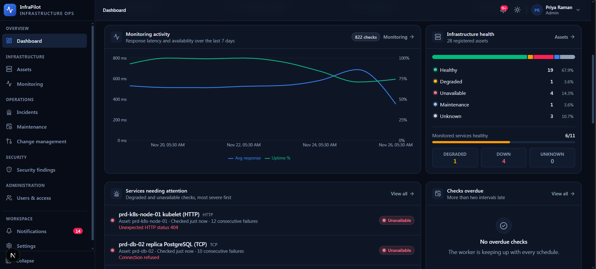
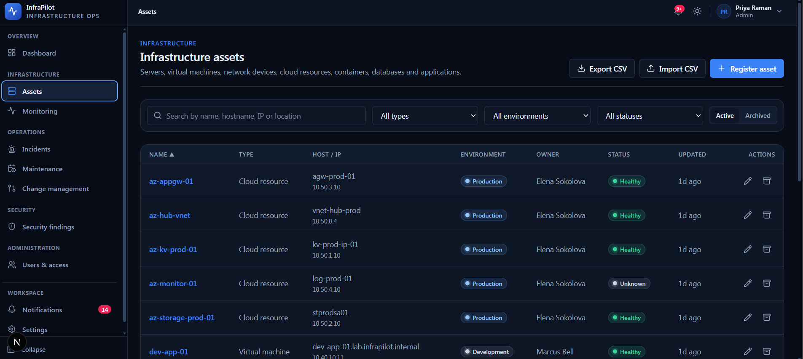
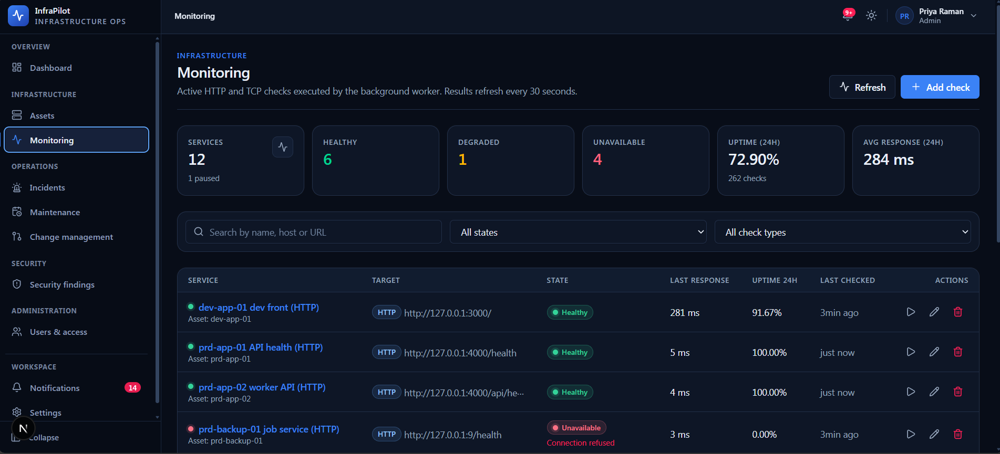

# InfraPilot

**An infrastructure operations platform for visibility, monitoring, incident response, and security management.**

InfraPilot gives infrastructure and operations teams one place to understand the state of their environment and coordinate day-to-day operational work. Instead of checking asset inventories, service health, incidents, maintenance schedules, change requests, and security findings in separate places, operators can use a shared workspace to review these areas and follow up on issues.

## Why InfraPilot?

The purpose of InfraPilot is to help teams answer practical operational questions:

- What infrastructure assets and services are registered?
- Which resources are healthy, degraded, unavailable, or in maintenance?
- Are monitored services responding as expected?
- What incidents need investigation or resolution?
- What maintenance and infrastructure changes are planned?
- Which security findings need attention?
- What operational alerts and activity should administrators review?

The dashboard brings important signals together, while the dedicated sections provide places to investigate and manage each area. Monitoring runs through a separate worker process, allowing scheduled checks and monitoring activity to operate independently of the web interface.

## Screenshots

The following screenshots show the InfraPilot application interface.

### 1. Application dashboard


### 2. Infrastructure operations view



### 3. Monitoring and service health



### 4. Operational management



### 5. Security and administration


## Main features

| Area | Purpose |
| --- | --- |
| **Dashboard** | Review an operational overview, including asset health, uptime, monitoring activity, incidents, security findings, and upcoming maintenance. |
| **Assets** | Maintain an inventory of infrastructure assets and review their current status. |
| **Monitoring** | Manage monitored services with per-target failure/recovery/latency thresholds, uptime and p95/p99 analytics, and check history. |
| **Alerts** | Alert console with deduplication, acknowledgement, suppression and resolution; every transition keeps an actor-stamped history. |
| **Incidents** | Manage incidents with priority-based SLA targets, MTTA/MTTR metrics, acknowledgement, and a correlated timeline (monitoring, changes, findings). |
| **Maintenance** | Plan and track scheduled maintenance activities. |
| **Change management** | Coordinate infrastructure change requests and their approval workflow. |
| **Security findings** | Vulnerability register with CVSS, component versions, remediation deadlines and safe **Trivy JSON report import**. |
| **Users & access** | Administer workspace users and access. |
| **Search** | Global search across assets, checks, alerts, incidents, findings, maintenance, changes and (admin only) users. |
| **Notifications** | Review operational alerts and workspace notifications. |
| **Settings** | Manage application and workspace configuration. |

## How to use InfraPilot

A typical workflow for a local demonstration or evaluation is:

1. **Prepare the environment.** Install the required Node.js dependencies and configure MongoDB and the application environment variables.
2. **Initialize the database.** Run the MongoDB initialization command. This prepares the application's database structures and required initial data.
3. **Optionally load demo data.** Seed the presentation dataset so the dashboard and operational sections have sample records to display.
4. **Start the application processes.** Run the backend API, monitoring worker, and frontend in separate terminals.
5. **Open the web interface.** Visit http://localhost:3000 and sign in with an account configured for your environment.
6. **Explore the workspace.** Start at the Dashboard, then open Assets and Monitoring to review infrastructure and service health. Visit Incidents, Maintenance, Change management, and Security findings to explore the operational workflows. Notifications and Users & access provide supporting workspace and administration views.

The monitoring worker should remain running while demonstrating scheduled monitoring activity.

## Architecture

InfraPilot uses a multi-process architecture with shared packages:


| Component | Responsibility |
| --- | --- |
| `apps/frontend` | Next.js 16 / React 19 application UI |
| `apps/backend` | Express REST API exposed at `/api/v1` |
| `apps/worker` | Independent MongoDB monitoring worker |
| `packages/database` | Shared MongoDB connection and repository entry point |
| `packages/server-core` | Shared business services and server helpers |
| `packages/contracts` | Shared API contracts |

The runtime application data layer is **MongoDB**. PostgreSQL and Drizzle packages remain only as migration-tool dependencies for `scripts/migrate-data.ts`; they are not used by runtime application services.

## Local development

### Prerequisites

- Node.js and npm compatible with the project
- MongoDB 8 configured as a replica set
- Environment variables configured using `.env.example`

### Setup

1. Copy `.env.example` to `.env` and configure the MongoDB connection, database name, JWT secrets, and any other required settings. Keep real secrets in your local `.env`; do not commit them.
2. Install dependencies:

   ```powershell
   npm ci
   ```

3. Initialize MongoDB without dropping existing data:

   ```powershell
   npm run db:init:mongo
   ```

4. Start each process in a separate terminal from the repository root:

   **Terminal 1 — backend API**
   ```powershell
   npm run dev:backend
   ```

   **Terminal 2 — monitoring worker**
   ```powershell
   npm run dev:worker
   ```

   **Terminal 3 — frontend**
   ```powershell
   npm run dev:frontend
   ```

5. Open http://localhost:3000.

The backend API runs at `http://localhost:4000`, and the frontend uses the `/api/v1` proxy for API requests.

## Demo data

To populate the application with the presentation dataset, configure `DEMO_SEED_PASSWORD` in your local `.env`, then run:

```powershell
npm run db:seed:demo
npm run db:verify:demo
```

The demo dataset is intended for demonstrations and evaluation. Do not use demo credentials or sample records as production data.

To remove the demo dataset:

```powershell
npm run db:seed:demo:cleanup -- --yes
```

See [docs/demo-environment.md](docs/demo-environment.md) for additional demo environment details.

## Monitoring, analytics and alerting

The background worker claims each due target with a **lease** (`claimExpiresAt`), so two workers never
probe the same target and a crashed worker's targets are reclaimed when the lease expires. After each
check the worker evaluates configurable thresholds (`failureThreshold`, `recoveryThreshold`,
`warningThresholdMs`, `criticalThresholdMs`) and drives the alert lifecycle:

- **Deduplication** — a partial unique index allows exactly one active alert per
  `targetId:condition`, so concurrent workers cannot duplicate alerts; recurrences after resolution
  open a new alert.
- **Maintenance suppression** — checks covered by an active maintenance window still record their real
  result, but alert escalation and automatic incident creation are suppressed until the window ends.
- **Automatic incidents** — critical alerts open an incident (unique per alert) with a system comment;
  recovery adds a comment but never auto-closes the incident.
- **Analytics** — uptime for 24 h/7 d/30 d plus average/min/max/p95/p99 latency and trends, aggregated
  by MongoDB from stored results.

See [docs/monitoring-alerting.md](docs/monitoring-alerting.md) for thresholds, the state machine,
endpoints and operational notes.

## Security operations: Trivy report import

`POST /api/v1/security/imports` accepts a Trivy JSON report for an asset. InfraPilot parses it as data,
validates size (≤ 2 MB), entry count (≤ 1,000) and CVE identifiers, and creates or refreshes findings
keyed by asset/CVE/package. The upload is never executed and InfraPilot does **not** run Trivy itself:
findings reflect the report's scan time and are labelled `source: trivy`.

Remediation deadlines follow the severity policy (critical 7 days, high 30, medium 90, low 180,
informational 365) and drive the overdue counters on the security dashboard. Details and the exact
request/response contract: [docs/security-operations.md](docs/security-operations.md).

## Incident SLA and timelines

Incidents carry priority-based SLA targets (P1 15 min/4 h, P2 30 min/8 h, P3 2 h/24 h, P4 8 h/72 h).
`GET /api/v1/incidents/sla` reports MTTA, MTTR, breaches and at-risk incidents; only incidents that are
actually resolved contribute to MTTR, and unresolved incidents are never counted as met. The incident
detail timeline merges comments with the originating monitoring alert's events, change requests that
touch affected assets, and open findings on those assets, each labelled with its source.
See [docs/incident-intelligence.md](docs/incident-intelligence.md).

## Configuration

Copy `.env.example` and set at least `MONGODB_URI`, `JWT_ACCESS_SECRET` (≥ 32 characters) and, in
production, `APP_ORIGIN`. Monitoring and alerting knobs:

| Variable | Default | Purpose |
| --- | --- | --- |
| `MONITOR_TICK_MS` | 5000 | Scheduler interval. |
| `MONITOR_BATCH_SIZE` | 25 | Targets claimed per tick. |
| `MONITOR_MAX_CONCURRENCY` | 5 | Concurrent probes per worker process. |
| `MONITOR_FAILURE_THRESHOLD` | 3 | Default consecutive failures before unavailable. |
| `MONITOR_RECOVERY_THRESHOLD` | 2 | Default successes required to resolve an alert. |
| `MONITOR_WARNING_THRESHOLD_MS` | 1500 | Default warning latency. |
| `MONITOR_CRITICAL_THRESHOLD_MS` | 5000 | Default critical latency. |
| `MONITOR_RETENTION_DAYS` | 30 | Check-result retention. |
| `AUTO_INCIDENT_ENABLED` | true | Environment switch for automatic incidents (targets can opt out). |
| `REQUIRED_CHANGE_APPROVALS` | 1 | Approvals needed before a change is approved. |

Full deployment configuration, TLS and backup guidance: [docs/deployment.md](docs/deployment.md).

## Testing

```powershell
npm test                 # unit, component and validation tests (integration suites skip without MONGODB_URI)
npm run test:integration # MongoDB-backed alert, lease and worker-pipeline tests (needs MONGODB_URI)
npm run test:e2e         # Playwright against a running stack
npm run typecheck
npm run lint
npm run build
```

Unit tests cover alert classification, threshold resolution, deduplication keys, maintenance
suppression, SLA arithmetic and the Trivy parser. Integration tests run the real worker sequence
(probe → state → record → alerts) against a replica set and prove deduplication, automatic incidents,
suppression and recovery. Playwright covers the alert console, global search and a Trivy import.

## Continuous integration

`.github/workflows/ci.yml` runs with least-privilege permissions and commit-SHA-pinned actions:

- **Quality** — install, lint, type generation + type check, unit/component tests, production dependency
  audit, build.
- **MongoDB integration and worker pipeline** — replica set, collection/index initialization,
  `npm run test:integration`, and a worker boot/health smoke test.
- **End-to-end** — replica set, seed, demo idempotency/cleanup verification, build, Playwright.
- **Code scanning** — CodeQL (`security-and-quality` queries).
- **Secret scanning** — gitleaks on the full history.
- **Dependency scanning** — `npm audit --omit=dev --audit-level=high` in the quality job. GitHub's
  dependency-review API is not available to this repository's plan, so the action is deliberately not
  used instead of being left failing or ignored.

## Security model

- JWT access tokens are short-lived and held in memory; refresh tokens live in an httpOnly cookie.
- Role checks (`read`/`write`/`admin`) are enforced server-side on every route; route parameters are
  UUID-validated and cross-origin mutations are refused unless the origin matches.
- Monitoring destinations are validated (scheme, credentials, private/loopback/metadata ranges) before
  storage and re-validated at probe time; redirects are not followed.
- Uploaded scan reports are parsed defensively, bounded in size/count, and never executed.
- 5xx responses are masked; errors carry a request ID that matches structured logs.
- Audit entries record actor, action, entity and IP for alert, incident, finding, import and auth
  actions.

## Data model

MongoDB is the only runtime database. Collections, indexes and schema-tolerance notes for alerts,
scan imports and the extended incident/finding/monitoring documents are documented in
[docs/database/mongodb.md](docs/database/mongodb.md). `initializeAppDatabase()` is idempotent and never
drops or rewrites existing data.

## Operating notes

- Backend and worker are independent processes. The backend serves the API, health checks and the
  frontend proxy; the worker owns scheduled checks, alert evaluation and retention pruning.
- The worker exposes `/health/live` and `/health/ready` on `WORKER_HEALTH_PORT` (4010) and records a
  heartbeat that `/health/worker` and the dashboard use.
- Deploy multiple worker replicas safely: claims are leases, and alert/incident deduplication is
  enforced by unique indexes.
- `docs/deployment.md` covers reverse proxying, backups and the production checklist.

## Troubleshooting

| Symptom | Check |
| --- | --- |
| `/health/ready` returns 503 | MongoDB reachability; the response lists the failing dependency. |
| `/health/worker` reports no active worker | Worker process, `WORKER_HEALTH_PORT`, and the heartbeat in `worker_statuses`. |
| A target never runs | `enabled` flag, `nextCheckAt`, and whether an expired `claimExpiresAt` is reclaimable. |
| Alerts are suppressed unexpectedly | Active maintenance window covering the asset, or a manual suppression with `suppressedUntil`. |
| Trivy import returns 422 | Report shape (`Results`), size (≤ 2 MB), CVE identifiers, and the 1,000-entry limit. |
| Login loops | `JWT_ACCESS_SECRET` stability across restarts and the refresh cookie's `Secure` flag over HTTPS. |

## Delivered scope and remaining work

Implemented in this iteration: alert lifecycle with database-enforced deduplication, configurable
thresholds, real analytics (uptime/p95/p99), maintenance suppression, automatic incidents with recovery
correlation, incident SLA metrics and acknowledgement, a correlated incident timeline, safe Trivy report
import with a security dashboard, global search, worker leases, and integration/unit/E2E coverage.

Not yet implemented, and therefore not claimed anywhere in the UI: CMDB relationships and a topology
graph, change impact analysis, PDF exports, dashboard widget customisation, and per-field granular
permissions beyond the existing role model. Dedicated CSV exports exist for assets and incidents;
further report formats remain on the roadmap.

## Documentation index

| Document | Contents |
| --- | --- |
| [docs/monitoring-alerting.md](docs/monitoring-alerting.md) | Thresholds, alert state machine, deduplication, suppression, incidents, analytics API. |
| [docs/security-operations.md](docs/security-operations.md) | Trivy import contract, validation, deduplication, remediation policy, permissions. |
| [docs/incident-intelligence.md](docs/incident-intelligence.md) | SLA policy and metrics, timeline correlation, global search. |
| [docs/database/mongodb.md](docs/database/mongodb.md) | Collections, indexes, schema tolerance. |
| [docs/deployment.md](docs/deployment.md) | Production deployment, TLS, backups, checklist. |
| [docs/api.md](docs/api.md) | REST API reference. |
| [docs/demo-environment.md](docs/demo-environment.md) | Demo dataset, credentials, cleanup. |

## Useful commands

```powershell
# Quality checks
npm test
npm run typecheck
npm run build
npm run lint

# Start application processes
npm run dev:backend
npm run dev:worker
npm run dev:frontend

# MongoDB setup and demo data
npm run db:init:mongo
npm run db:seed:mongo
npm run db:seed:demo
npm run db:verify:demo
npm run db:seed:demo:cleanup -- --yes
```

Docker Compose is optional. It can run MongoDB, backend, frontend, and worker:

```powershell
docker compose up --build
```
