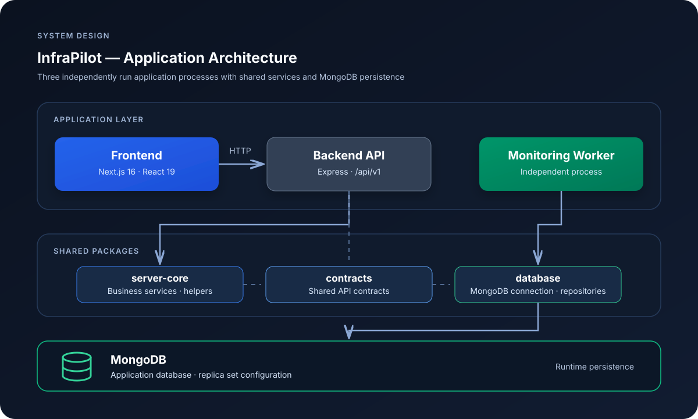

# InfraPilot

**Infrastructure operations, monitoring, and security in one workspace.**

InfraPilot is an infrastructure operations application built around a three-process architecture. It brings infrastructure inventory, service monitoring, incident response, maintenance planning, change management, and security findings into one operational interface.

## Architecture



| Component | Responsibility |
| --- | --- |
| `apps/frontend` | Next.js 16 / React 19 application UI |
| `apps/backend` | Express REST API exposed at `/api/v1` |
| `apps/worker` | Independent monitoring worker |
| `packages/database` | Shared MongoDB connection and repository entry point |
| `packages/server-core` | Shared business services and server helpers |
| `packages/contracts` | Shared API contracts |

The runtime application data layer is **MongoDB**. PostgreSQL and Drizzle packages remain only as migration-tool dependencies for `scripts/migrate-data.ts`; they are not used by runtime application services.

## Application areas

The workspace navigation is organized around these operational areas:

| Area | What it covers |
| --- | --- |
| **Dashboard** | Operational overview with asset health, uptime, monitoring activity, open incidents, security findings, and upcoming maintenance |
| **Assets** | Infrastructure asset inventory and current resource status |
| **Monitoring** | Monitored services, availability checks, response latency, and check history |
| **Incidents** | Operational incidents and their resolution workflow |
| **Maintenance** | Planned maintenance activities and schedules |
| **Change management** | Infrastructure change requests and change coordination |
| **Security findings** | Security issues, severity, and remediation tracking |
| **Users & access** | Workspace users and access administration |
| **Notifications** | Operational alerts and workspace notifications |
| **Settings** | Application and workspace configuration |

### Dashboard preview

The dashboard brings key operational signals together, including registered and healthy assets, unavailable resources, monitored services, uptime, open incidents, critical/high findings, and upcoming maintenance. Monitoring activity and infrastructure health panels provide additional visibility into service performance and asset status.

> Dashboard figures are generated from the configured database and monitoring history. They are environment-specific and can change as the worker processes checks or operators update records.

## Demo environment

For a presentation dataset, use the demo seed workflow:

```powershell
npm run db:seed:demo
npm run db:verify:demo
```

To remove the demo dataset:

```powershell
npm run db:seed:demo:cleanup -- --yes
```

See [docs/demo-environment.md](docs/demo-environment.md) for the demo environment details. Configure `DEMO_SEED_PASSWORD` in your local `.env` before seeding. Do not commit real credentials or populated production data.

## Local development

1. Copy `.env.example` to `.env` and configure a MongoDB 8 replica set and JWT secret.
2. Install dependencies:

   ```powershell
   npm ci
   ```

3. Initialize the database without dropping existing data:

   ```powershell
   npm run db:init:mongo
   ```

4. Start each process in a separate terminal:

   ```powershell
   npm run dev:backend
   npm run dev:worker
   npm run dev:frontend
   ```

The frontend uses `http://localhost:3000`, the backend uses `http://localhost:4000`, and the API proxy is `/api/v1`.

## Useful commands

```powershell
npm test
npm run typecheck
npm run build
npm run lint

npm run dev:backend
npm run dev:worker
npm run dev:frontend

npm run db:init:mongo
npm run db:seed:mongo
npm run db:seed:demo
npm run db:verify:demo
npm run db:seed:demo:cleanup -- --yes
```

Docker Compose is optional. It can run MongoDB, backend, frontend, and worker:

```powershell
docker compose up --build
```
