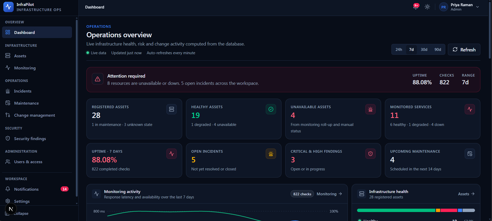
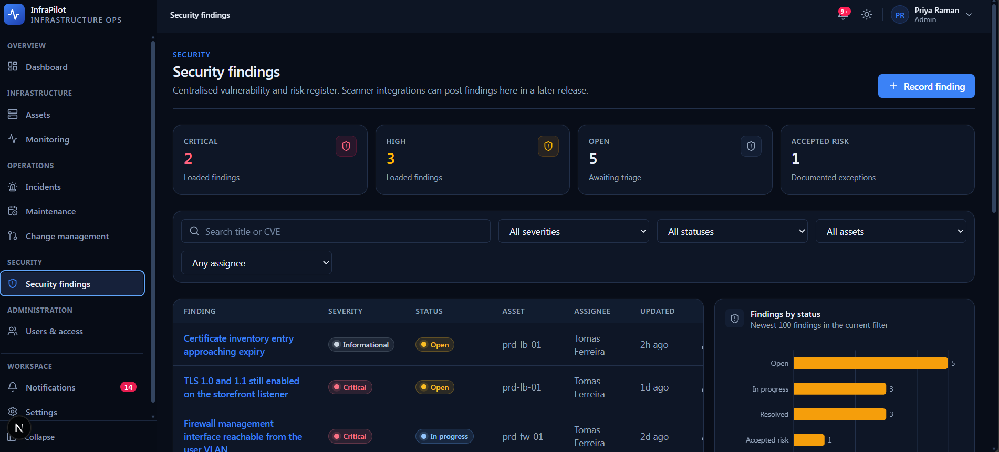

# InfraPilot

**An infrastructure operations platform for visibility, monitoring, incident response, and security management.**

InfraPilot gives infrastructure and operations teams one place to understand the state of their environment and coordinate day-to-day operational work. Instead of checking asset inventories, service health, incidents, maintenance schedules, change requests, and security findings in separate places, operators can use a shared workspace to review these areas and follow up on issues.

## Why InfraPilot?

The purpose of InfraPilot is to help teams answer practical operational questions:

- What infrastructure assets and services are registered?
- Which resources are healthy, degraded, unavailable, or in maintenance?
- Are monitored services responding as expected?
- What incidents need investigation or resolution?
- What maintenance and infrastructure changes are planned?
- Which security findings need attention?
- What operational alerts and activity should administrators review?

The dashboard brings important signals together, while the dedicated sections provide places to investigate and manage each area. Monitoring runs through a separate worker process, allowing scheduled checks and monitoring activity to operate independently of the web interface.

## Screenshots

The following screenshots show the InfraPilot application interface.

### 1. Application dashboard



### 2. Infrastructure operations view


### 3. Monitoring and service health


### 4. Operational management


### 5. Security and administration



## Main features

| Area | Purpose |
| --- | --- |
| **Dashboard** | Review an operational overview, including asset health, uptime, monitoring activity, incidents, security findings, and upcoming maintenance. |
| **Assets** | Maintain an inventory of infrastructure assets and review their current status. |
| **Monitoring** | Manage monitored services and review availability checks, response times, and check history. |
| **Incidents** | Review and manage operational incidents through their resolution workflow. |
| **Maintenance** | Plan and track scheduled maintenance activities. |
| **Change management** | Coordinate infrastructure change requests and their approval workflow. |
| **Security findings** | Review security issues, severity, and remediation progress. |
| **Users & access** | Administer workspace users and access. |
| **Notifications** | Review operational alerts and workspace notifications. |
| **Settings** | Manage application and workspace configuration. |

## How to use InfraPilot

A typical workflow for a local demonstration or evaluation is:

1. **Prepare the environment.** Install the required Node.js dependencies and configure MongoDB and the application environment variables.
2. **Initialize the database.** Run the MongoDB initialization command. This prepares the application's database structures and required initial data.
3. **Optionally load demo data.** Seed the presentation dataset so the dashboard and operational sections have sample records to display.
4. **Start the application processes.** Run the backend API, monitoring worker, and frontend in separate terminals.
5. **Open the web interface.** Visit http://localhost:3000 and sign in with an account configured for your environment.
6. **Explore the workspace.** Start at the Dashboard, then open Assets and Monitoring to review infrastructure and service health. Visit Incidents, Maintenance, Change management, and Security findings to explore the operational workflows. Notifications and Users & access provide supporting workspace and administration views.

The monitoring worker should remain running while demonstrating scheduled monitoring activity.

## Architecture

InfraPilot uses a multi-process architecture with shared packages:


| Component | Responsibility |
| --- | --- |
| `apps/frontend` | Next.js 16 / React 19 application UI |
| `apps/backend` | Express REST API exposed at `/api/v1` |
| `apps/worker` | Independent MongoDB monitoring worker |
| `packages/database` | Shared MongoDB connection and repository entry point |
| `packages/server-core` | Shared business services and server helpers |
| `packages/contracts` | Shared API contracts |

The runtime application data layer is **MongoDB**. PostgreSQL and Drizzle packages remain only as migration-tool dependencies for `scripts/migrate-data.ts`; they are not used by runtime application services.

## Local development

### Prerequisites

- Node.js and npm compatible with the project
- MongoDB 8 configured as a replica set
- Environment variables configured using `.env.example`

### Setup

1. Copy `.env.example` to `.env` and configure the MongoDB connection, database name, JWT secrets, and any other required settings. Keep real secrets in your local `.env`; do not commit them.
2. Install dependencies:

   ```powershell
   npm ci
   ```

3. Initialize MongoDB without dropping existing data:

   ```powershell
   npm run db:init:mongo
   ```

4. Start each process in a separate terminal from the repository root:

   **Terminal 1 — backend API**
   ```powershell
   npm run dev:backend
   ```

   **Terminal 2 — monitoring worker**
   ```powershell
   npm run dev:worker
   ```

   **Terminal 3 — frontend**
   ```powershell
   npm run dev:frontend
   ```

5. Open http://localhost:3000.

The backend API runs at `http://localhost:4000`, and the frontend uses the `/api/v1` proxy for API requests.

## Demo data

To populate the application with the presentation dataset, configure `DEMO_SEED_PASSWORD` in your local `.env`, then run:

```powershell
npm run db:seed:demo
npm run db:verify:demo
```

The demo dataset is intended for demonstrations and evaluation. Do not use demo credentials or sample records as production data.

To remove the demo dataset:

```powershell
npm run db:seed:demo:cleanup -- --yes
```

See [docs/demo-environment.md](docs/demo-environment.md) for additional demo environment details.

## Useful commands

```powershell
# Quality checks
npm test
npm run typecheck
npm run build
npm run lint

# Start application processes
npm run dev:backend
npm run dev:worker
npm run dev:frontend

# MongoDB setup and demo data
npm run db:init:mongo
npm run db:seed:mongo
npm run db:seed:demo
npm run db:verify:demo
npm run db:seed:demo:cleanup -- --yes
```

Docker Compose is optional. It can run MongoDB, backend, frontend, and worker:

```powershell
docker compose up --build
```
