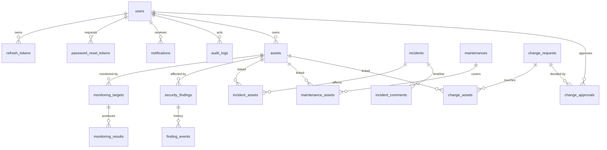

# InfraPilot — Architecture

## 1. Purpose

InfraPilot centralises infrastructure asset inventory, availability monitoring, security findings,
incident response, maintenance scheduling, and change management behind one role-aware console.

## 2. Technology decisions

| Concern | Choice | Rationale |
| --- | --- | --- |
| Application framework | Next.js 16 (App Router) | One deployable unit for UI and REST API; route handlers keep `/api/v1` close to the UI |
| Language | TypeScript (strict) | Shared Zod schemas between browser and server |
| Database | PostgreSQL 16 | Relational integrity, `FOR UPDATE SKIP LOCKED` for safe multi-worker scheduling |
| ORM | Drizzle ORM | Typed SQL builder, SQL migrations generated by drizzle-kit |
| Validation | Zod 4 | Identical rules in forms (client) and handlers (server) |
| Auth tokens | `jose` (HS256 JWT) | Maintained, standards-compliant JOSE implementation |
| Password hashing | scrypt (Node `crypto`) | Memory-hard KDF with no native dependency; interchangeable with Argon2id later |
| UI | Tailwind CSS v4, shadcn-style primitives, Lucide, Recharts | Free and open source; components are local and editable |
| Forms | React Hook Form + `@hookform/resolvers` | Uncontrolled inputs, Zod-driven validation |
| HTTP client | Axios | Interceptors for bearer tokens and single-flight refresh |
| Monitoring | Node `http`/`https`/`net` probes | No third-party agent; pinned-IP connections defeat DNS rebinding |
| Testing | Vitest, React Testing Library, Playwright | Unit, component and end-to-end layers |
| Packaging | Docker multi-stage, Compose, GitHub Actions | Reproducible local and CI builds |

## 3. Layered backend

```
HTTP request
  └─ app/api/v1/[...segments]/route.ts     Next.js entry point (thin)
       └─ routes/index.ts                  dispatcher: origin check, route matching, param validation,
                                           error mapping (toErrorResponse), access log
            └─ controllers/*.controller.ts HTTP adapters: authorise → parse/validate → call service → respond
                 └─ services/*.service.ts  business rules, transactions, notifications, audit
                      └─ db (Drizzle)      schema in src/db/schema.ts
```

Supporting modules:

- `src/lib/http.ts` — `ApiError`, JSON envelopes, pagination metadata, safe error conversion.
- `src/lib/auth.ts` — bearer verification against the database (role and active-state are re-read each request), role matrix, refresh cookie helpers, anti-CSRF header check.
- `src/lib/security.ts` — password hashing, JWT issue/verify, token hashing, fixed-window rate limiter.
- `src/lib/ssrf.ts` — URL parsing and network-destination policy.
- `src/lib/logger.ts` — structured JSON logs with recursive redaction of sensitive keys.
- `src/validators/schemas.ts` — every request body, query and transition rule.
- `src/workers/` — probe engine, state machine, scheduler, standalone worker entry point.
- `src/instrumentation.ts` — starts the scheduler inside the web process unless disabled.

### Why controllers and routes are split this way

The spec asks for separate routes, controllers, services, and middleware. In the Next.js App Router the
file-system route is a single catch-all handler, so routing is expressed as a declarative table
(`src/routes/index.ts` plus one `RouteDef[]` per module). Authentication and authorisation are invoked
explicitly by each controller through `authorize(req, "read" | "write" | "admin")`, which is the middleware
equivalent in this framework. No business logic lives in controllers or route files.

## 4. Frontend structure

- `src/app/(auth)` — login, registration, password reset (public).
- `src/app/(app)` — protected shell: layout guard, overview and module pages.
- `src/context` — auth session, toast notifications, theme.
- `src/lib/client` — Axios instance, single-flight refresh, `useAsync` data hook.
- `src/components` — UI primitives, charts, app shell, reusable forms (asset form, asset picker).

Access tokens are kept in memory. On page load the client calls `POST /api/v1/auth/refresh`; the httpOnly
refresh cookie restores the session without storing secrets in `localStorage`.

## 5. Database design (ERD)



Key constraints and policies:

| Table | Constraints / indexes | Deletion policy |
| --- | --- | --- |
| `users` | unique `email`; index `role` | Deactivation (`is_active`) preferred; hard delete not exposed |
| `refresh_tokens` | unique `token_hash`; indexes `user_id`, `family_id` | Cascade with user |
| `password_reset_tokens` | unique `token_hash` | Cascade with user |
| `assets` | indexes type, environment, status, hostname, name, archived_at | Soft archive (`archived_at`); owner set null |
| `monitoring_targets` | index `(enabled, next_check_at)` for scheduling; `asset_id` | Asset delete sets null |
| `monitoring_results` | index `(target_id, checked_at)`; `checked_at` for pruning | Cascade with target; pruned after `MONITOR_RETENTION_DAYS` |
| `security_findings` | indexes severity, status, asset, assignee | Asset delete sets null |
| `finding_events` | index `finding_id` | Cascade with finding |
| `incidents` | unique `number` (serial); indexes status, severity, assignee, opened_at | Assignee/reporter set null |
| `incident_assets`, `maintenance_assets`, `change_assets` | composite primary keys | Cascade both ways |
| `incident_comments` | index `incident_id` | Cascade with incident |
| `maintenances` | indexes starts_at, status | Owner set null |
| `change_requests` | unique `number`; indexes status, requester, risk | Requester set null |
| `change_approvals` | unique `(change_id, approver_id)` — one decision per approver | Cascade with change |
| `notifications` | index `(user_id, read_at)` | Cascade with user |
| `audit_logs` | index `(entity_type, entity_id)`, `created_at`, `actor_id` | Actor set null; rows are never updated |

Migrations live in `drizzle/` and are applied with `npx drizzle-kit migrate`.

## 6. Monitoring design

1. **Scheduling.** `claimDueTargets` selects due, enabled targets with `FOR UPDATE SKIP LOCKED`, then pushes
   `next_check_at` forward by `interval_seconds` in the same transaction. Several workers can run without
   double-probing a target.
2. **Concurrency.** A bounded pool (`MONITOR_MAX_CONCURRENCY`) runs probes; a `ticking` guard prevents
   overlapping scheduler passes.
3. **Probing.** HTTP uses `http`/`https` with `lookup` pinned to a pre-validated address. Redirects are not
   followed. Successful status defaults to 2xx/3xx or the configured expected code. TCP connects to the
   pinned address. Every probe has an enforced timeout.
4. **Validation at three points.** When a target is saved (synchronous DNS and policy check), when the worker
   runs it (re-validated, so DNS changes are caught), and at connection time (pinned IP).
5. **State.** `computeState` is a pure function: healthy, degraded (slow or first failures), unavailable
   (≥ `MONITOR_FAILURE_THRESHOLD` consecutive failures), unknown (never checked).
6. **Side effects.** Results are inserted, the target row is updated, state transitions create in-app
   notifications, and linked asset status is rolled up from its monitors. Assets with no monitors keep their
   manually maintained status, so registering an asset never implies monitoring.

## 7. Security architecture

| Control | Implementation |
| --- | --- |
| Password storage | scrypt, N=16384, r=8, p=1, 16-byte random salt, constant-time comparison |
| Password policy | ≥ 12 characters with upper, lower, digit (Zod schema, enforced server-side) |
| Account enumeration | Login and reset responses are uniform; login always performs a hash comparison |
| Access token | HS256 JWT, 15-minute TTL, issuer/audience checked, held in memory on the client |
| Refresh token | 384-bit random value, stored as SHA-256 hash, httpOnly + SameSite=Strict + Secure in production, path-scoped to `/api/v1/auth` |
| Rotation & revocation | Single use; reuse of a revoked token revokes the whole family; password change/reset, deactivation revoke all sessions |
| CSRF | State-changing cookie endpoints require `X-InfraPilot-Request: 1` (cannot be sent cross-site without CORS preflight); bearer-authenticated APIs are not cookie-authenticated |
| Origin checks | Non-GET requests with an `Origin` header must match the request origin or `APP_ORIGIN` |
| Authorisation | Role checked on every endpoint against the database value (`viewer` < `operator` < `admin`); self-demotion and self-deactivation blocked |
| Input validation | Zod for bodies, queries, path identifiers (UUID), enum values, lengths, URL schemes |
| SQL injection | Drizzle parameterised queries only; LIKE wildcards escaped in search |
| SSRF | Scheme allow-list, credential rejection, DNS resolution with full address-class policy, metadata endpoints always blocked, private ranges only with admin authorisation per target, pinned connections |
| Rate limiting | Fixed window per IP on login, registration, refresh, password reset and change |
| Headers | Helmet-equivalent headers in `next.config.ts`: CSP, frame-ancestors none, nosniff, referrer policy, permissions policy, COOP/CORP, HSTS in production |
| Error exposure | Unknown errors return a generic message with a request ID; stack traces are never returned |
| Logging | JSON logs; keys matching password/token/secret/authorization/cookie/hash are redacted |
| Audit | Immutable `audit_logs` written for security-relevant and business-state changes |

## 8. Known limitations

- Rate limiting is in-memory per process. Multi-instance deployments should move it to Redis.
- Mail delivery uses a log transport by default. Reset links are only echoed in responses when
  `EXPOSE_RESET_TOKEN=true` (development). Configure a real transport through `setMailTransport`.
- DNS rebinding is mitigated by connecting to pre-validated addresses; a determined attacker controlling
  a public host that later resolves to a private address is blocked at connect time by pinning, but the
  policy is evaluated on the resolved set at check time.
- Redirects are not followed by monitoring probes, which avoids redirect-based SSRF at the cost of not
  measuring post-redirect behaviour.
