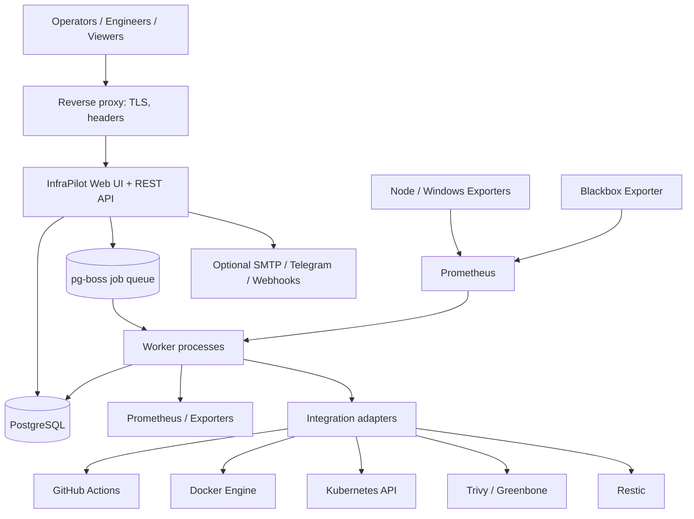
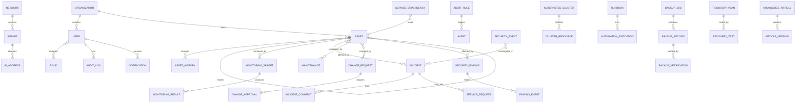
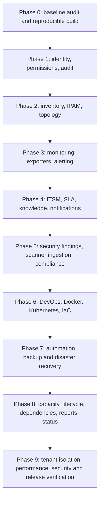

# InfraPilot Ultimate — System Architecture and Delivery Blueprint

> Status: Architecture baseline for the Ultimate roadmap. This document separates the capabilities already present in the repository from planned work. A feature is not considered complete merely because its navigation or UI exists.

## 1. Executive architecture decision

InfraPilot will evolve as a modular, self-hosted platform with a web control plane, PostgreSQL-backed operational data, isolated background workers, and optional adapters to external infrastructure tools.

**Preserve the existing Next.js + Drizzle implementation for the first delivery.** The repository already contains a working layered API, authentication, asset inventory, monitoring probes with SSRF controls, findings, incidents, maintenance, changes/approvals, notifications, dashboard, audit, Docker packaging and tests. Replacing it immediately with a separate Vite/Express/Prisma stack would create a high-risk rewrite without delivering additional user-facing capability. The current stack is free/open-source and supports the required product boundaries. If a separately deployable frontend/backend becomes necessary later, the API contract allows that extraction without changing domain services.

### Target deployment topology



The browser never receives infrastructure credentials or direct Docker/Kubernetes credentials. Integrations run server-side through least-privilege adapters. The API and workers are separate runtime processes even when they share one deployable image.

## 2. Service boundaries and modular backend

The initial deployment is a modular monolith with independently scalable worker processes. Domain boundaries are enforced in code; network boundaries are introduced only where they improve security or independent scaling.

| Boundary | Responsibilities | Runtime |
|---|---|---|
| Web control plane | UI, REST API, authentication, authorization, configuration, reports, audit | Next.js server |
| Core domain | Assets, users, incidents, changes, findings, IPAM, knowledge, cost, lifecycle | TypeScript services |
| Monitoring worker | Scheduled probes, exporter scraping/import, state transitions, alert evaluation | Worker process |
| Integration worker | GitHub, Docker, Kubernetes, Trivy, Greenbone, Restic and webhook polling | Worker process |
| Automation worker | Approved, allow-listed Ansible/runbook tasks in isolated execution environment | Separate restricted worker |
| PostgreSQL | Transactional records, job metadata, audit, operational history | PostgreSQL 16 |
| Prometheus | Time-series measurements and scrape history | Optional monitoring service |

Do not split every module into a microservice. Keep synchronous domain transactions in one service boundary and use queued jobs for slow, retryable or external work. Every integration must have a timeout, bounded concurrency, retry policy, idempotency key and health status.

## 3. Technology decisions

| Area | Existing / selected technology | Decision |
|---|---|---|
| UI | Next.js 16 App Router, React 19, TypeScript, Tailwind v4, local shadcn-style components, Lucide, Recharts | Retain existing UI and extend reusable primitives |
| Routing | Next.js route groups and protected layouts | Retain; add module navigation incrementally |
| API | Versioned REST API at `/api/v1`, Zod validation | Retain API contracts; document with OpenAPI |
| Server | Node.js 22+, TypeScript | Retain |
| Persistence | PostgreSQL 16 + Drizzle ORM + SQL migrations | Retain to avoid destructive ORM migration |
| Background jobs | pg-boss backed by PostgreSQL | Add for durable schedules, retries and job visibility; existing monitor scheduler remains until migration is tested |
| Monitoring | Prometheus, Blackbox Exporter, Node Exporter, Windows Exporter | Add as optional services; retain secure native HTTP/TCP probes |
| Infrastructure adapters | Docker Engine API, Kubernetes API, GitHub API, Terraform CLI/state metadata, Ansible | Server-side adapters only |
| Security scanners | Trivy; optional Greenbone Community Edition | Import normalized findings; scanner installation/configuration is external |
| Testing | Vitest, Testing Library, Playwright; Supertest where Express services exist | Retain Vitest/Playwright; API tests can exercise Request/Response handlers |
| Delivery | Docker, Compose, GitHub Actions | Retain; add service profiles and supply-chain checks |
| Code quality | ESLint, strict TypeScript, Prettier | Enforce in CI |

The uploaded reference stack names Vite, Express and Prisma. Those are valid open-source choices, but they are not the current repository stack. This blueprint intentionally preserves Next.js/Drizzle. A later extraction to Vite + Express + Prisma is a separate migration project and must not be mixed into feature delivery.

## 4. Feature classification and delivery scope

### Foundation already represented in the repository

The current codebase includes the following implemented domains, subject to verification and hardening:
- Registration, login, logout, refresh-token rotation, password reset, profile and password change.
- Three current roles (administrator, operator, viewer), with API-side permission checks.
- Asset CRUD, archive/restore, ownership, history and relationships.
- HTTP/HTTPS and TCP monitoring, bounded worker concurrency, target validation and SSRF protections.
- Security findings with severity, assignment and remediation history.
- Incidents, comments/timeline, asset association and resolution data.
- Maintenance scheduling and asset association.
- Change requests, approval decisions, implementation and rollback workflow.
- In-app notifications, dashboard analytics, user administration and audit logs.
- Docker Compose, CI, unit/component/E2E test foundations and deployment docs.

This baseline is narrower than the Ultimate requirements. Do not label the following roadmap domains complete until both API and UI workflows exist and are tested.

### MVP completion (priority order)

| Priority | Domain | Minimum functional acceptance |
|---|---|---|
| P0 | Foundation hardening | Reproducible lockfile, clean install, lint/typecheck/build, migration and seed repeatability, auth and RBAC regression tests |
| P0 | User/role administration | Permission matrix, account/session visibility, role changes and audit events |
| P0 | Asset management | Full asset fields, lifecycle history, CSV import/export, filtering and asset relationships |
| P0 | Monitoring | Target types, history/retention, alert rules, Prometheus/Blackbox integration, threshold UI, worker health |
| P0 | ITSM | Incident comments, service requests, assignment, priorities, SLA timestamps, escalation and linked alerts/findings/changes |
| P0 | Network/IPAM | IPv4/IPv6 CIDR validation, networks, subnets, VLANs, gateways, address allocations/reservations and duplicate prevention |
| P0 | Audit/notifications | Searchable audit, per-user preferences, email/webhook adapters, delivery retry/history |
| P1 | Network topology | React Flow editor, persisted nodes/edges, labels, import/export and asset links |
| P1 | Vulnerability management | CVE/CVSS fields, scanner import, deduplication, remediation status and export |
| P1 | Change/maintenance | Risk assessment, maintenance windows, approval policy, SLA/notification integration |
| P1 | Knowledge base | Categorized articles, tags, search, revision history and access control |
| P1 | Reporting | CSV/PDF reports, date filters, generated-at metadata and scheduled delivery |
| P1 | Backup/DR | Restic job inventory, verification records, restore-test evidence, RPO/RTO tracking |
| P2 | DevOps integrations | GitHub repositories/workflows/deployments and deployment history |
| P2 | Docker/Kubernetes | Read-only host/cluster inventory and health using restricted credentials |
| P2 | IaC/runbooks | Terraform metadata/plan records, Ansible inventory and approved isolated execution |
| P2 | Security operations | Structured event ingestion, rule-based correlation, investigation and incident linking |
| P2 | Compliance/configuration | Framework control mapping, evidence records, baselines, drift tracking and remediation |
| P2 | Capacity/lifecycle/cost | Resource trends and explicitly labelled forecasts, warranties/licenses, manual cost allocation |
| P3 | Advanced operations | Service dependency graph, root-cause investigation workspace, public status page, scheduled reports |
| P3 | Multi-tenant readiness | Organization-scoped ownership, membership, authorization and tenant isolation tests before enabling tenants |

## 5. Data architecture and ERD

Use normalized relational records for business entities and configuration. Store high-frequency time series in Prometheus; retain only rollups, alert events and operational references in PostgreSQL. Use JSONB only for versioned adapter payloads or flexible evidence metadata, not as a replacement for relational constraints.

### Domain entities

- Identity: Organization, User, Role, Permission, UserRole, Session, RefreshToken, PasswordResetToken.
- Inventory: Asset, AssetHistory, AssetRelationship, SoftwareInventory, Warranty, License, CostRecord.
- Network: Network, Subnet, IPAddress, VLAN, NetworkDevice, NetworkConnection, DNSRecord.
- Observability: MonitoringTarget, MonitoringResult, MetricReference, AlertRule, Alert, ProbeExecution.
- Security: SecurityFinding, FindingEvent, SecurityEvent, DetectionRule, ComplianceFramework, ComplianceControl, Assessment, Evidence.
- ITSM: Incident, IncidentComment, IncidentEvent, ServiceRequest, SLARecord, Maintenance, ChangeRequest, ChangeApproval.
- Delivery: GitRepository, Pipeline, WorkflowRun, Deployment, ContainerHost, ContainerRecord, KubernetesCluster, ClusterResource.
- Automation: Runbook, RunbookVersion, AutomationExecution, ExecutionApproval, ExecutionLog.
- Resilience: BackupJob, BackupRecord, BackupVerification, RecoveryPlan, RecoveryTest.
- Knowledge: KnowledgeArticle, ArticleVersion, ArticleTag.
- Platform: Integration, IntegrationCredentialReference, Notification, NotificationPreference, NotificationDelivery, AuditLog, ScheduledReport, JobExecution, ServiceDependency.

### Relationship overview



### Database rules

1. Add `organization_id` to tenant-owned records before enabling multi-tenant mode; initially seed one organization and enforce a single-organization scope.
2. Use UUID primary keys, UTC timestamptz, explicit foreign keys, unique constraints and indexes for common filters.
3. Use soft deletion/archive for assets, users and knowledge records where history must remain.
4. Keep audit events append-only; do not update or delete audit rows through application APIs.
5. Enforce unique IP allocation within a subnet using normalized address storage and a transaction/constraint strategy; validate CIDR in application code.
6. Keep secrets outside normal domain tables. Store only a secret-manager reference or encrypted credential envelope with key rotation support.
7. Use migration files only; never mutate production schema through runtime auto-sync.
8. Retain Prometheus samples externally; PostgreSQL stores scrape configuration, last-known state, alert events and summarized reporting snapshots.

## 6. API architecture

All endpoints use `/api/v1`, JSON request/response envelopes, request IDs, consistent errors and Zod schemas. Collections use cursor or page pagination consistently, explicit sort allowlists, filters and bounded page sizes.

| Resource prefix | Main operations |
|---|---|
| `/auth`, `/users`, `/roles`, `/sessions` | Login/refresh/logout/reset, profile, user administration, permissions and sessions |
| `/assets`, `/asset-relationships`, `/software`, `/licenses` | CRUD, history, archive, import/export, lifecycle |
| `/networks`, `/subnets`, `/ip-addresses`, `/vlans`, `/topologies` | CIDR/IPAM, reservations, duplicate checks, topology persistence |
| `/monitoring/targets`, `/monitoring/results`, `/alerts`, `/metrics` | Configuration, history, thresholds, active alerts and Prometheus references |
| `/findings`, `/security-events`, `/compliance` | Findings, ingestion, investigation, controls and evidence |
| `/incidents`, `/service-requests`, `/slas` | Ticket lifecycle, comments, assignment, escalation and service metrics |
| `/maintenance`, `/changes`, `/approvals` | Scheduling, risk, approval, implementation and rollback records |
| `/repositories`, `/pipelines`, `/deployments` | GitHub integration, workflow status and releases |
| `/container-hosts`, `/containers`, `/clusters`, `/cluster-resources` | Read-only container and Kubernetes inventory |
| `/terraform`, `/runbooks`, `/automation-executions` | State metadata, plan records, approved automation jobs |
| `/backup-jobs`, `/backups`, `/recovery-plans`, `/recovery-tests` | Backup inventory, verification and restore-test evidence |
| `/knowledge`, `/dependencies`, `/notifications`, `/reports`, `/audit` | Articles, service graph, delivery preferences, exports and audit search |

Every operation must document method, path, permission, validation, success schema, error codes and side effects in OpenAPI. Integration webhooks must authenticate signatures and reject replayed delivery IDs. Long-running tasks return a job ID; clients poll job status instead of holding HTTP connections open.

## 7. Authentication and authorization

- Retain short-lived signed access tokens in memory and rotating refresh tokens in secure, httpOnly, SameSite cookies.
- Hash refresh tokens at rest; revoke token families on reuse, password reset, account deactivation or administrative session revocation.
- Add password reset rate limits, uniform responses and single-use expiry.
- Introduce explicit permissions (e.g. `assets.read`, `assets.write`, `monitoring.admin`, `automation.approve`) and map roles to permissions. Existing administrator/operator/viewer roles remain supported during migration.
- Enforce authorization inside every controller/service boundary; UI visibility is not a security control.
- Require separation of duties for high-risk automation and production changes; block self-approval where policy requires a second approver.
- Scope every query by organization from the authenticated principal before multi-tenant enablement.
- Record actor, organization, action, entity, request ID, timestamp and redacted before/after diff in the audit stream.
- Add optional OIDC and TOTP only after baseline session security and recovery flows are tested.

## 8. Monitoring and agent architecture

### Data flow

1. Admin registers an authorized target or connects Prometheus.
2. API validates protocol, DNS, destination policy, timeout, interval and credential reference.
3. Durable scheduler enqueues due work; workers claim jobs with bounded concurrency.
4. Adapter performs a pinned, time-limited probe or queries Prometheus.
5. Worker stores last-known state and alert transitions in PostgreSQL; high-frequency samples remain in Prometheus.
6. Alert evaluator applies threshold, deduplication, maintenance suppression and correlation rules.
7. Notification dispatcher records each delivery attempt and retries transient failures.

### Exporter deployment

- Prometheus scrapes Node Exporter and Windows Exporter on managed hosts.
- Blackbox Exporter performs HTTP, TCP, DNS and ICMP checks where permitted.
- InfraPilot stores scrape target metadata and queries Prometheus using a server-side adapter.
- Credentials and scrape configuration must be restricted to authorized networks.
- A host agent is optional; prefer established exporters over a custom privileged agent.

### Safety requirements

Monitoring and discovery are restricted to explicitly authorized destinations. Block loopback, link-local, cloud metadata and private ranges unless a specific target/network has been approved. Revalidate DNS and pin validated addresses at connection time. Do not follow redirects by default. Apply egress network policies in addition to application validation.

## 9. Integration architecture

Each integration implements a common adapter contract: `validateConfig`, `testConnection`, `sync`, `health`, `redact` and `disconnect`. Credentials are injected at runtime from environment secrets or a secret store; they are never returned to the browser.

| Integration | Scope | Permission model |
|---|---|---|
| Prometheus / exporters | Metrics and target health | Read-only query/scrape credentials |
| GitHub | Repository, workflow, release and deployment metadata | Fine-grained read-only token; optional webhook secret |
| Docker Engine | Container/host inventory and resource status | Dedicated restricted endpoint/proxy; never expose raw socket to browser |
| Kubernetes | Nodes, namespaces, pods, deployments, services | Read-only ServiceAccount, namespace scoping |
| Trivy | Image/filesystem vulnerability ingestion | Isolated scanner process; import signed/validated output |
| Greenbone CE | Optional vulnerability scan results | External installation and API credential |
| Terraform | Workspace/project metadata, plan artifacts and status | Never expose state contents or secret values in logs |
| Ansible | Inventory and approved playbook execution | Isolated runner, allow-listed playbooks, no arbitrary shell |
| Restic | Backup snapshots, verification and restore-test records | Dedicated backup account and repository permissions |
| SMTP / Telegram / Webhooks | Notifications | Optional, per-integration credentials and delivery audit |

Adapters are optional. Core inventory, incidents, change management and manual backup evidence remain usable when no external integration is configured.

## 10. Security architecture

- Threat model browser, API, worker, database, integration endpoints and operator credentials separately.
- Use secure headers, strict CORS allowlist, same-origin checks, CSRF protections for cookie-authenticated state changes, rate limits and request-size limits.
- Use parameterized SQL and server-side Zod validation; escape user-controlled content in rendered markdown.
- Prevent SSRF, DNS rebinding, metadata access and arbitrary network scanning.
- Do not offer arbitrary shell, Docker socket, Kubernetes write or Terraform apply operations through the public API.
- Run workers as non-root with read-only filesystems where practical, resource limits, isolated networks and narrowly scoped secrets.
- Require explicit authorization and approval for privileged automation, production changes and network discovery.
- Encrypt backups and integration secrets; document key rotation and restore tests.
- Add dependency audit, secret scanning, container image scanning, SBOM generation and signed release artifacts to CI.
- Keep security events and audit records separate: an event is an observed signal; an audit record is an application action.

## 11. Complete target directory structure

The repository will evolve incrementally; this is the logical target layout, not a requirement to move existing files in one destructive refactor.

```text
infrapilot/
  src/
    app/                         # Next.js pages, layouts, API entry points
    components/                  # Design system and shared visualizations
    context/                     # Auth, theme, notifications
    modules/
      identity/                  # Users, roles, permissions, sessions
      inventory/                 # Assets, history, lifecycle, licenses
      network/                   # IPAM, VLAN, topology, discovery
      monitoring/                # Targets, metrics, alerts, dashboards
      security/                  # Findings, events, compliance, evidence
      itsm/                      # Incidents, requests, SLA, maintenance, changes
      devops/                    # Repositories, pipelines, deployments, IaC
      compute/                   # Docker and Kubernetes inventory
      automation/                # Runbooks, approvals, execution history
      resilience/                # Backup, recovery plans, restore tests
      knowledge/                 # Articles, versions, search
      reporting/                 # Reports, schedules, exports
      platform/                  # Notifications, audit, integrations, tenants
    controllers/                 # HTTP adapters
    services/                    # Domain/application services
    repositories/                # Data access abstractions (introduced as needed)
    integrations/                # Prometheus, GitHub, Docker, K8s, Trivy, Restic
    workers/                     # Monitoring, integrations, notifications, reports
    validators/                  # Shared Zod contracts
    db/                          # Drizzle schema, connection, seeds
    lib/                          # Auth, security, HTTP, config, logger
  drizzle/                        # SQL migrations and metadata
  monitoring/
    prometheus/
    blackbox/
    exporters/
  agents/                         # Optional host-side collectors
  docker/                         # Runtime and hardening configuration
  docs/
  scripts/
  tests/
    unit/
    integration/
    components/
  e2e/
  .github/workflows/
  Dockerfile
  docker-compose.yml
  .env.example
  README.md
```

## 12. Delivery phases and dependencies



### Phase exit criteria

- **Phase 0:** inspect every existing route/service/schema/test; clean install; lockfile; lint, typecheck, tests and build; fix known cross-origin login regression; baseline feature matrix.
- **Phase 1:** explicit permission matrix, session management, account controls, append-only audit tests.
- **Phase 2:** IPAM constraints, subnet calculator tests, topology persistence and CSV import/export.
- **Phase 3:** Prometheus/Blackbox integration, alert lifecycle, retention and worker observability.
- **Phase 4:** service requests, SLA calculations, escalation, maintenance suppression, knowledge articles.
- **Phase 5:** Trivy import, deduplication, CVSS/CVE, event ingestion and evidence-based control assessments.
- **Phase 6:** GitHub integration, Docker read-only inventory, Kubernetes read-only inventory and Terraform metadata.
- **Phase 7:** allow-listed automation with approvals and isolated execution; Restic inventory and verified restore-test evidence.
- **Phase 8:** scheduled PDF/CSV reporting, capacity projections labelled as estimates, lifecycle and cost reporting, public status allowlist.
- **Phase 9:** tenant-scope tests, threat model review, load tests, backup restore drill, deployment runbook and release checklist.

## 13. Resource requirements

### Development workstation

- Minimum: 4 CPU cores, 8 GB RAM, 20 GB free disk for web app + PostgreSQL development.
- Recommended: 8 CPU cores, 16 GB RAM, 40 GB free disk for app, database, Prometheus and test containers.
- Docker Desktop or Docker Engine; Node.js 22+; Git; PostgreSQL can run via Compose.

### Self-hosted evaluation deployment

- Small evaluation (web + DB + one worker): 2–4 vCPU, 4–8 GB RAM, 40 GB SSD.
- Monitoring-enabled lab (Prometheus, exporters, workers): 4–8 vCPU, 8–16 GB RAM, 80+ GB SSD depending on scrape interval and retention.
- Production sizing must be load-tested against target count, check frequency, metrics retention, job concurrency and report workload. Do not promise fixed capacity before benchmarking.

## 14. Local deployment architecture

Default Compose profile:
- `db`: PostgreSQL 16 with persistent volume and health check.
- `migrate`: one-shot migration job.
- `app`: non-root web/API process behind a reverse proxy.
- `worker`: monitoring and asynchronous job process.
- `prometheus`, `blackbox-exporter`: optional monitoring profile.
- `node-exporter`: optional host metrics; Windows Exporter is installed on Windows targets separately.
- Optional integration containers (e.g. Trivy) are enabled only when explicitly configured.

Use `.env` for local secrets and a secret manager in production. Bind PostgreSQL to an internal Compose network; expose only the reverse proxy/web entry point. Configure TLS at the proxy, health checks, resource limits, persistent volumes, backup schedule and restore drill. No paid cloud service is required.

## 15. Risks, trade-offs and non-goals

| Risk | Mitigation |
|---|---|
| Scope spans many enterprise domains | Phase gates and acceptance criteria; deliver vertical slices |
| Rewriting the existing stack | Preserve Next.js/Drizzle; isolate any future migration |
| External tools require separate setup | Optional adapters, connection test, clear health state and setup docs |
| High-frequency metrics overload PostgreSQL | Prometheus for time series; DB for configuration, alerts and rollups |
| Privileged automation can damage infrastructure | Separate worker, allowlists, approval, sandboxing, audit and least privilege |
| Multi-tenant leaks | Organization scoping in repositories and authorization tests before tenant enablement |
| False claims of security/compliance/DR | Evidence-backed states; distinguish configured, observed, tested and verified |
| Integration API changes or rate limits | Adapter versioning, retries, backoff, idempotency and health reporting |

Non-goals for the first release: arbitrary remote shell, unrestricted infrastructure mutation, an AI-driven SOC, automatic compliance certification, or a claim that backups are recoverable without restore evidence.

## 16. Definition of done

A module is complete only when it has:
1. Persistent data model and migration.
2. Validated, authenticated, permission-checked API.
3. Functional UI for list, detail, create/update and relevant workflows.
4. Audit and notification side effects where appropriate.
5. Unit and integration tests, plus E2E coverage for critical workflows.
6. Documentation, configuration examples and operational troubleshooting.
7. Observable failure states and safe retry/rollback behavior.
8. Verified Docker deployment and CI checks where relevant.

Track each feature as **Implemented**, **Tested**, **Configured**, or **Production-deployed**. These are distinct states; never infer one from another.
